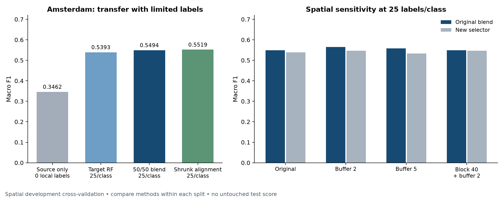

# Building Age Classification

### Transfer learning from Madrid to Amsterdam

A reproducible spectral-data workflow for classifying building age with limited target-city labels. The competition focus is **25 labeled Amsterdam locations per class: 100 adaptation labels per run**.

**Recommended model:** a fixed 50/50 probability blend of a Madrid random forest and an Amsterdam random forest. It achieves **0.5494 macro F1 ± 0.0258 fold SD** and **0.5636 weighted F1** on the original spatial development folds. Shrunk alignment reaches 0.5519 macro F1, but its small gain is uncertain. No untouched competition-test score is available.



## Competition documentation

| Document | Contents |
|---|---|
| [Methods](docs/METHODS.md) | Data preparation, labels, model and validation protocol |
| [Results](docs/RESULTS.md) | Model comparisons, class-level performance and limitations |
| [Reproduction guide](docs/REPRODUCIBILITY.md) | Environment, execution order, verification and artifacts |
| [Submission checklist](docs/SUBMISSION.md) | Deliverables, presentation points and outstanding requirements |
| [Madrid pretraining and fine-tuning](docs/TORCH_TRANSFER.md) | Fixed RF–neural hybrid reaches 0.5679 development macro F1; trade-offs and controls |
| [PyTorch experiments](docs/PYTORCH.md) | Neural model recommendations and matched RF comparisons |
| [Complete score table](docs/results/all_model_scores.csv) | Machine-readable results for all 64 evaluated configurations |

## Project layout

```text
notebooks/
  workflow/       Data audit, preprocessing, baseline and evaluation
  experiments/    Alignment, adapters, grid search and 25/class experiments
  reference/      Original numbered challenge notebooks
scripts/          Training helpers, inference safeguards and verification

docs/             Competition documentation and presentation figure
data/             Local datasets, models and reproducible experiment artifacts
pyproject.toml    Project dependencies
uv.lock           Locked environment
```

## Quick start

The complete experimental RF–PyTorch hybrid is in [hybrid_rf_pytorch.ipynb](notebooks/workflow/hybrid_rf_pytorch.ipynb), including training, spatial evaluation, model export and prediction. It requires the preprocessed data and the optional `deep-learning` extra.

```bash
uv sync --locked
uv run --with jupyter jupyter lab
```

Place the supplied `madrid_train.parquet` and `amsterdam_data.parquet` files in `data/`. Start with the notebooks in [notebooks/workflow](notebooks/workflow), following the [reproduction guide](docs/REPRODUCIBILITY.md). Every notebook resolves the repository root before accessing project files.

To assemble a clean competition handoff:

```bash
uv run python scripts/package_submission.py --include-models
```

The archive contains the documentation, notebooks, executable helpers, environment files and available baseline model artifacts. Raw datasets and local development configuration are excluded. Review the [submission checklist](docs/SUBMISSION.md) before uploading.
