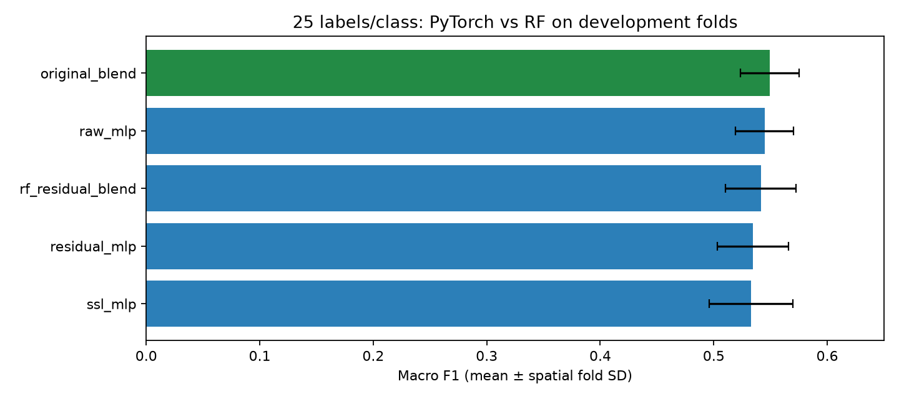

# PyTorch experiments for building-age classification

**Follow-up:** [Madrid supervised pretraining and Amsterdam fine-tuning](TORCH_TRANSFER.md) produced a fixed RF–neural hybrid at **0.5679 macro F1** (+0.0185 versus RF), with more severe errors. The first-round results below remain unchanged.

Our first PyTorch comparisons **do not improve macro F1**. Keep the fixed Madrid/Amsterdam RF probability blend as the recommended model. The raw MLP is the strongest neural model tested here, with a mean deficit of 0.0047 macro F1. This is a development result, not evidence that all deep learning methods will underperform.

## Which algorithms fit this problem?

The current inputs are **54 numerical summaries** (nine statistics for each of six spectral bands), with **four age classes and 25 Amsterdam labels/class**. Coordinates define spatial splits and are excluded from predictors. These are tabular inputs; adjacent summary columns are not uniformly spaced time steps.

| Priority | Algorithm | Why consider it here? | Status |
|---|---|---|---|
| 1 | Small regularized MLP | Accessible PyTorch baseline for 54 continuous inputs; low capacity is a sensible starting point with 100 local labels | Existing PyTorch predictions verified |
| 2 | Small residual MLP | Skip connections allow incremental feature transformations; tests whether a deeper tabular model helps | Implemented and trained here |
| 3 | Madrid supervised pretraining, then Amsterdam fine-tuning | Gives a neural model access to the source supervision used by the RF; compare frozen head vs small-learning-rate fine-tuning | Recommended next experiment; untested |
| 4 | TabM | Parameter-efficient ensembling provides another tabular neural candidate; benchmark under the same label budget | Untested |
| 5 | FT-Transformer | Per-feature tokens and attention can learn interactions among spectral summaries; higher compute and overfitting risk make it a later experiment | Untested |
| Separate raw-data experiment | Temporal 1D CNN/TCN | Can learn spectral changes from ordered multiband observations, with time gaps, padding masks and missingness handled explicitly | Requires a new sequence pipeline; untested |

The [tabular-model authors' implementation](https://github.com/yandex-research/rtdl-revisiting-models) identifies MLP and ResNet as useful baselines and reports that FT-Transformer is slower. [TabM's official repository](https://github.com/yandex-research/tabm) describes parameter-efficient ensembles. These sources motivate candidates; their benchmark results do not predict a gain on these cities. Priority ordering above is a judgment based on this project's feature type and label budget.

A frozen denoising autoencoder has already been tried. Its reconstruction objective need not preserve age-discriminative information, so repeating that exact configuration is a lower priority. Supervised pretraining is a different experiment. City-specific class boundaries must be checked before treating Madrid and Amsterdam labels as interchangeable.

## Matched comparison

Five original spatial development folds × three identical adaptation-label samples per fold. Each run uses exactly **100 Amsterdam training labels**, balanced at 25/class. We average repetitions within each fold, then average the five fold means. Standard deviation is over those five means; it is not a confidence interval.

| Method | Macro F1 | Fold SD | Weighted F1 | Δ macro F1 vs RF |
|---|---:|---:|---:|---:|
| Original RF blend | **0.5494** | 0.0258 | **0.5636** | — |
| Raw PyTorch MLP | 0.5447 | 0.0254 | 0.5579 | −0.0047 |
| Fixed 50/50 RF–residual blend | 0.5416 | 0.0310 | 0.5509 | −0.0078 |
| Residual PyTorch MLP | 0.5346 | 0.0314 | 0.5439 | −0.0148 |
| Frozen denoising encoder + PyTorch MLP | 0.5328 | 0.0369 | 0.5481 | −0.0166 |

Raw MLP and denoising scores are recomputed from pre-existing artifacts, not newly trained models in this comparison. Residual scores are from new training. RF probabilities are taken from the saved original-regime improvement experiment and their predictions are checked against the original baseline for every location/fold/repetition. The RF uses Madrid labels; the standalone neural models do not. Thus the Amsterdam budget is matched, but source supervision is not. The earlier [scikit-learn autoencoder experiment](SELF_SUPERVISED.md) is a separate implementation with different optimization and scores.



### Per-class F1

| Method | Class 1 | Class 2 | Class 3 | Class 4 |
|---|---:|---:|---:|---:|
| Original RF blend | 0.6337 | 0.5872 | 0.4847 | 0.4919 |
| Raw PyTorch MLP | 0.6404 | 0.5302 | 0.5396 | 0.4687 |
| Residual MLP | 0.6326 | 0.5065 | 0.5210 | 0.4783 |
| Fixed RF–residual blend | 0.6370 | 0.5169 | 0.5262 | 0.4861 |
| Frozen encoder + MLP | 0.6427 | 0.5214 | 0.5199 | 0.4471 |

The raw MLP improves class 3 F1 but loses ground on classes 2 and 4. Both the residual model and its RF blend trail the RF on all five fold means. We have not tuned blend weights or architectures on these results.

## PyTorch implementation and controls

The raw MLP is 54 → 32 → 4 with ReLU and dropout 0.2. The frozen SSL model uses a 54 → 64 → 16 → 64 → 54 denoising autoencoder, then a 16 → 32 → 4 classifier. Its existing manifest and prediction hashes are verified before comparison.

The new residual MLP projects 54 inputs to width 32, applies two residual blocks, then predicts four logits. Each block uses LayerNorm, Linear, ReLU, dropout, Linear and dropout. LayerNorm is a deliberate small-sample variant; this is **not an exact reproduction** of the RTDL ResNet architecture. Median imputation and standardization fit only on the 100 labeled training locations for each run.

Training uses 300 full-batch epochs, AdamW (learning rate 0.001, weight decay 0.01), dropout 0.2 and cross entropy. Architecture, epoch budget and 50/50 blend weight were fixed before running the new comparison; there is no outer-fold early stopping or parameter search. Class IDs 1–4 are mapped to 0–3, and raw logits enter [CrossEntropyLoss](https://docs.pytorch.org/docs/2.15/generated/torch.nn.CrossEntropyLoss.html); softmax is used for inference. Seeds and deterministic algorithms follow [PyTorch's reproducibility guidance](https://docs.pytorch.org/docs/2.15/notes/randomness.html). Exact reproducibility across versions/platforms is not guaranteed.

The saved SSL pretraining excludes outer validation features and groups. All new training also excludes outer validation locations and groups. Existing used spatial folds can still be optimistic because of prior experimentation and touching blocks. No independent competition test is available. No significance claim is made from fold SD or the 15 correlated runs.

## Run and learn

Open [the comparison notebook](../notebooks/experiments/pytorch_comparison.ipynb) for architecture inspection, loss curves, score plots and paired fold differences. Its default cells verify and inspect artifacts; training is an explicit separate command.

```bash
uv sync --locked --extra deep-learning
uv run --extra deep-learning python -m scripts.compare_torch
uv run --extra deep-learning python -m scripts.compare_torch --verify
```

The optional extra pins PyTorch 2.15.0. The executed environment used PyTorch 2.15.0+cpu; no GPU was available. If the prerequisites are missing, run the existing baseline and original-regime improvement workflows, then `python -m scripts.self_supervised_torch` in the PyTorch environment. The comparison deliberately requires these saved artifacts rather than silently regenerating them with different settings.

[Training and verification helper](../scripts/compare_torch.py), [score CSV](results/torch_comparison_scores.csv). Regenerable predictions, split audits, training losses, paired deltas, per-class scores and SHA-256 manifests are under `data/torch_comparison/`. Implementation guidance used the installed scikit-learn skill and its model-evaluation reference. Firecrawl developer search failed DNS resolution; official references above were retrieved through the web fallback.

## Conclusion

**No mean macro-F1 gain was obtained. Retain the RF blend at 0.5494.** Use the raw PyTorch MLP at 0.5447 as the neural learning baseline. The next experiment I recommend is supervised Madrid pretraining with carefully controlled Amsterdam fine-tuning, followed by TabM. Select checkpoints and settings using inner spatial splits only, and reserve a new untouched geographic test for a final comparison. Those future methods have no measured score here.
