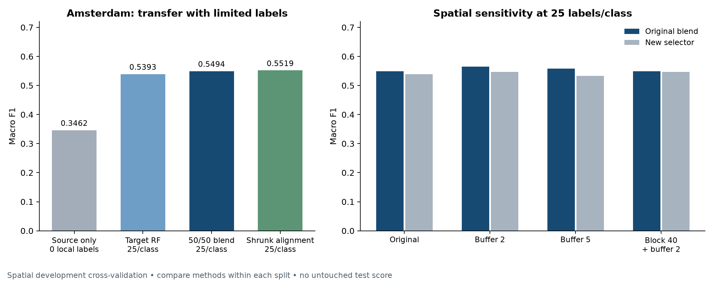

# Results

## Competition recommendation

Present the **original 50/50 source–target blend** as the main 25/class model: **0.5494 macro F1 ± 0.0258 fold SD**, with **0.5636 weighted F1**. Shrunk alignment reaches **0.5519 macro F1**, the highest original-fold score at this budget, but its small gain is uncertain. It is an experimental comparison, not a confirmed replacement.

All results are **spatial development cross-validation**. No untouched competition-test data were available. The primary budget is 25 labels per class: **100 Amsterdam adaptation labels per run**.

## Equal-budget comparison on the original folds

Five spatial outer folds and three matched sampling repetitions. Repetitions average within folds before averaging fold means.

| Model | Macro F1 | Fold SD | Weighted F1 |
|---|---:|---:|---:|
| Shrunk alignment | 0.5519 | 0.0242 | 0.5638 |
| Robust-feature RF | 0.5502 | 0.0294 | 0.5617 |
| Original 50/50 blend | 0.5494 | 0.0258 | 0.5636 |
| Full alignment | 0.5437 | 0.0242 | 0.5554 |
| Nested leaf-transfer selector | 0.5435 | 0.0252 | 0.5594 |
| Calibrated RF | 0.5433 | 0.0289 | 0.5546 |
| Regularized RF | 0.5424 | 0.0298 | 0.5544 |
| Grid-selected transfer | 0.5424 | 0.0235 | 0.5566 |
| Target-only RF | 0.5393 | 0.0232 | 0.5546 |
| New inner-selected procedure | 0.5391 | 0.0223 | 0.5524 |
| Ordinal RF | 0.5302 | 0.0313 | 0.5395 |
| Source-leaf ablation | 0.5074 | 0.0183 | 0.5236 |

Macro F1 weights each class equally; weighted F1 uses class support. Fold SD is not a confidence interval. A small numerical lead does not establish a meaningful gain.

## Per-class F1 for the presentation models

| Model | Class 1 | Class 2 | Class 3 | Class 4 |
|---|---:|---:|---:|---:|
| Target-only RF | 0.6462 | 0.5299 | 0.5268 | 0.4544 |
| Original 50/50 blend | 0.6337 | 0.5872 | 0.4847 | 0.4919 |
| Shrunk alignment | 0.6353 | 0.5737 | 0.4977 | 0.5008 |

Class 3 is weakest for the original blend (F1 0.4847) and shrunk alignment (0.4977). Inspect class-specific precision/recall and confusion patterns before proposing targeted changes.

## Spatial robustness at 25/class

| Validation regime | Original blend F1 | New selector F1 | Paired Δ | Conditional 95% interval |
|---|---:|---:|---:|---|
| Original folds | 0.5494 | 0.5391 | -0.0103 | [-0.0180, -0.0029] |
| 2-key-unit buffer | 0.5651 | 0.5469 | -0.0182 | [-0.0261, -0.0089] |
| 5-key-unit buffer | 0.5583 | 0.5332 | -0.0251 | [-0.0349, -0.0156] |
| 40-key blocks + 2-unit buffer | 0.5488 | 0.5470 | -0.0018 | [-0.0126, +0.0152] |

Compare methods within each row. Buffers change the eligible adaptation samples; larger blocks also change validation membership. Coordinate units remain unconfirmed. The new selector has lower mean F1 and more severe errors in every regime. In the primary 2-unit-buffer comparison, severe errors rise from **0.0801** to **0.1044**. Retain the original blend.

The paired spatial-block intervals are conditional on saved models and samples. They omit retraining uncertainty, some spatial/CV dependence and adjustment for repeated experimentation. They are exploratory diagnostics.

## Supplementary label-budget experiments

| Method | 5/class | 25/class | 50/class | 100/class | 200/class |
|---|---:|---:|---:|---:|---:|
| Target-only RF | 0.4322 | 0.5393 | 0.5822 | 0.6127 | 0.6302 |
| Original 50/50 blend | 0.4737 | 0.5494 | 0.5887 | 0.6168 | 0.6321 |
| Full alignment | 0.4580 | 0.5437 | 0.5837 | 0.6107 | 0.6283 |
| Shrunk alignment | 0.4824 | 0.5519 | 0.5906 | 0.6132 | 0.6295 |
| Nested leaf-transfer selector | 0.4652 | 0.5435 | 0.5889 | 0.6136 | 0.6289 |
| Source-leaf ablation | 0.4235 | 0.5074 | 0.5443 | 0.5897 | 0.6115 |
| Grid-selected transfer | 0.4543 | 0.5424 | 0.5858 | 0.6174 | 0.6355 |

The highest observed 200/class score, **0.6355**, uses 800 target labels. It is not a 25/class result.

Context: Madrid RF macro F1 is **0.5755**, versus **0.1313** for the most-frequent dummy. Madrid-to-Amsterdam source-only macro F1 is **0.3462** with zero local labels. These are different evaluation settings, not equal-budget competitors.

## PyTorch transfer follow-up

A fixed 50/50 blend of the original RF blend and a Madrid-pretrained, Amsterdam-fine-tuned MLP reaches **0.5679 macro F1 ± 0.0158 fold SD**, versus **0.5494** for RF on the same original spatial development folds and exact 25/class samples. Weighted F1 is **0.5769**. Severe errors increase from **0.0863 to 0.0953**. The fine-tuned network alone scores **0.5353**, below the new scratch control (**0.5534**); the hybrid gain cannot be attributed specifically to pretraining. Source-label harmonization and source checkpoint holdout differ from the RF procedure. Treat this as a promising experimental candidate pending robustness checks and an untouched test; the original RF remains the conservative recommendation. See the [full transfer report](TORCH_TRANSFER.md) and [separate score table](results/torch_transfer_scores.csv).

## CatBoost follow-up

Regularized CatBoost with inner spatial selection at 25 Amsterdam labels/class reaches **0.5252 macro F1** target-only and **0.5412** with a fixed Madrid/Amsterdam blend. The fixed CatBoost–fine-tuned-MLP hybrid reaches **0.5618**, below the existing RF–neural hybrid at **0.5679**, with severe-error rates **0.0978 versus 0.0953**. No primary mean-score improvement was obtained. See the [CatBoost report](CATBOOST.md) and [separate score CSV](results/catboost_scores.csv).

## TabPFN-v2 follow-up

The fixed **25% Madrid RF + 25% Amsterdam RF + 50% TabPFN-v2** blend reaches **0.5842 macro F1 ± 0.0174 fold SD** and **0.5931 weighted F1**, compared with **0.5679** macro F1 for the previous RF–fine-tuned-MLP hybrid. Severe errors fall from **0.0953 to 0.0831**. The new blend leads on all five original fold means using the exact same 25/class samples. TabPFN-v2 alone scores **0.5709**. This is the leading measured development candidate in these follow-ups, pending an independent geographic or competition test. The public original v2 checkpoint was tested with four inference estimators on CPU; **TabPFN-3.5 was not tested**. See the [TabPFN report](TABPFN.md), [notebook](../notebooks/experiments/tabpfn_experiment.ipynb) and [separate score CSV](results/tabpfn_scores.csv).

## Diagnostics and verification

- Shrunk alignment gains **+0.0025 macro F1** at 25/class; its conditional interval **[−0.0050, +0.0090]** includes zero. Its small gain also comes with more severe errors and worse saved fold-0 probability diagnostics.
- The newer experiments saved probabilities for all folds/repetitions. In the primary buffered regime, selection worsens log loss (**1.0719 vs 1.0514**) while improving Brier (**0.5737 vs 0.5789**). Better probability metrics alone do not establish a better classifier.
- Abstention thresholds use inner predictions only. Accepted-only scores must be shown with actual coverage; they do not replace scores for all locations.
- Six-band grouped SHAP checks on eight held-out locations reconstruct probabilities within **2.22 × 10⁻¹⁶**. Minimum per-class rank correlation across background choices is **0.60**, indicating reference sensitivity. Explanations are descriptive, not causal.
- Verification recomputed **420 run scores from 2,183,328 probability rows**, including all 60 exact label budgets, inner selections and spatial exclusions. Grid verification separately checked 75 selections and 150 held-out scores.

## Limitations and next priorities

All local datasets have informed development. City-specific age boundaries, mixed-age pixel targets and touching spatial blocks limit interpretation. No new annotations, building footprints or confirmed physical metadata were supplied.

Prioritize organizer confirmation of labels and units, an untouched geographic test and reliable spatially diverse Amsterdam labels. A larger tuning grid is not the leading improvement supported by current evidence.

The [complete CSV](results/all_model_scores.csv) contains all **64 configurations**, including weighted and per-class F1. See [Methods](METHODS.md), [Reproduction](REPRODUCIBILITY.md) and the [submission checklist](SUBMISSION.md).
