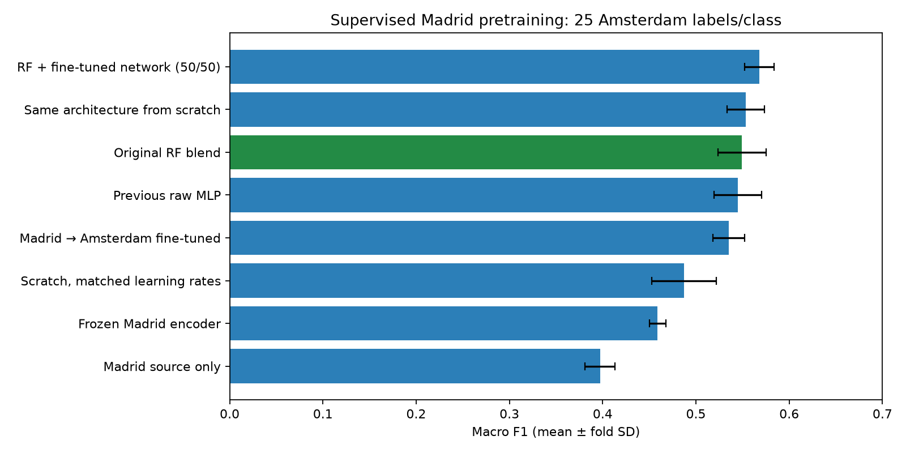

# Madrid pretraining and Amsterdam fine-tuning

The fixed **50/50 RF–fine-tuned-network probability blend** achieves **0.5679 macro F1 ± 0.0158 fold SD**, compared with **0.5494 ± 0.0258** for the existing RF blend: a **+0.0185** development gain (1.85 percentage points). This is a promising candidate, not a confirmed independent-test improvement. The network alone does not beat the RF, and pretraining does not beat the strongest scratch control.

## Fixed experiment

The inputs are the existing 54 spectral summary features. No coordinates, construction years, age labels or label-derived eligibility fields enter the predictors. The primary Amsterdam budget remains **25 locations/class, 100 labels/run**, using the exact existing five spatial folds and three adaptation samples per fold. Repetitions average within folds first. All settings below, including the RF blend weight, were recorded before the new outer evaluation; no architecture or epoch search used these results.

Madrid's original first age-class boundary is 1960, whereas Amsterdam's is 1945. To pretrain a network for the target task, we derive Madrid labels from its supplied weighted mean construction years with right-closed boundaries **1945, 1984, 2004, 2024**. This changes **8,450 Madrid labels** from class 1 to class 2. Amsterdam labels are unchanged. This harmonization is an explicit experimental choice; organizer confirmation of target definitions remains outstanding. Source years are used only to construct the supervised label vector.

The network is **54 → 64 → 32 → 4**, with ReLU and dropout 0.2 after each hidden layer. Source preprocessing is median imputation and standardization fitted on Madrid folds 1–4 only, comprising **61,010 locations**. Madrid fold 0 contains **15,253 checkpoint locations** in disjoint spatial groups. Class-weighted cross entropy handles the harmonized source imbalance. Source training uses AdamW, learning rate 0.001, weight decay 0.01, batches of 512, at most 80 epochs and patience 12. Checkpoint macro F1 selects epoch **52**, scoring **0.6028** on the Madrid checkpoint fold. This is a selected source-development score, not an Amsterdam or untouched test score. Training stopped after epoch 64.

All new neural methods use the same source-fitted preprocessing. No Amsterdam features enter source fitting or checkpoint selection. A fresh, identically initialized classifier head is used for each adaptation control, with 300 full-batch epochs, AdamW and weight decay 0.01:

| Method | Initialization | Encoder learning rate | Head learning rate |
|---|---|---:|---:|
| Frozen encoder | Madrid encoder, fresh head | Frozen | 0.001 |
| Fine-tuned | Madrid encoder, fresh head | 0.0001 | 0.001 |
| Scratch | Random encoder and head | 0.001 | 0.001 |
| Scratch, matched LR | Random encoder and head | 0.0001 | 0.001 |

The frozen encoder stays in evaluation mode during head training to disable its dropout. Fine-tuning updates all parameters. There is no target checkpoint selection, and no extra target labels are reserved or consumed. The source-only diagnostic retains the Madrid-trained classifier head. A single pretrained source model is shared across all adaptation runs; source pretraining-seed variability has not been measured.

This follows the freezing and fine-tuning distinction in the official [PyTorch transfer-learning tutorial](https://docs.pytorch.org/tutorials/beginner/transfer_learning_tutorial.html); its image architecture is not used here. Differential learning rates use the documented [optimizer parameter groups](https://docs.pytorch.org/docs/2.15/optim.html#per-parameter-options). The installed scikit-learn skill and model-evaluation guidance informed the training-only preprocessing, group exclusions and matched comparisons.

## Matched development results

| Method | Macro F1 | Fold SD | Weighted F1 | Δ macro F1 vs RF | Severe errors |
|---|---:|---:|---:|---:|---:|
| **RF + fine-tuned network, fixed 50/50** | **0.5679** | 0.0158 | **0.5769** | **+0.0185** | 0.0953 |
| New architecture from scratch | 0.5534 | 0.0199 | 0.5634 | +0.0040 | 0.1107 |
| Existing RF blend | 0.5494 | 0.0258 | 0.5636 | — | **0.0863** |
| Previous raw PyTorch MLP | 0.5447 | 0.0254 | 0.5579 | −0.0047 | 0.1101 |
| Madrid → Amsterdam fine-tuned | 0.5353 | 0.0172 | 0.5410 | −0.0141 | 0.1123 |
| Scratch, matched differential LR | 0.4873 | 0.0346 | 0.4968 | −0.0621 | 0.1421 |
| Frozen Madrid encoder + new head | 0.4587 | 0.0088 | 0.4605 | −0.0907 | 0.1381 |
| Madrid source only, no target labels | 0.3973 | 0.0161 | 0.3995 | −0.1521 | 0.1111 |

Severe errors mean predicted and true classes differ by at least two. Source-only uses zero target labels and is a diagnostic rather than an equal-budget adaptation method. The previous raw MLP and RF predictions are reused and checked for exact location/fold/repetition alignment; all other predictions are newly generated. The RF uses all Madrid labels with the original city-specific source boundary, whereas the new neural model uses harmonized labels and a source checkpoint holdout. These are complete-procedure comparisons, not an isolated architecture benchmark.



### What improved, and what did not?

The fixed hybrid improves macro F1 over the RF by **+0.0279, +0.00002, +0.0105, +0.0131 and +0.0409** on fold means 0–4. One difference is essentially a tie. Fold SD is descriptive, not a confidence interval; folds and repetitions are dependent. We make no statistical significance claim.

Fine-tuning improves on frozen features by **+0.0766** and on the matched-low-learning-rate scratch control by **+0.0480**. However, it trails the ordinary-learning-rate scratch control by **−0.0181**. These controls support a benefit from pretrained initialization under the low encoder learning rate, but **do not establish an overall advantage from pretraining over a suitably trained scratch network**. The source-fitted scaler and new architecture also differ from the previous raw MLP.

The hybrid's gain is consistent with complementary prediction errors, but does not identify the cause. We have not tested a matched RF–scratch blend, source-label ablations, harmonization ablations or multiple source seeds. Any such follow-up should be declared before execution, with tuning confined to inner spatial splits.

The hybrid raises the severe-error rate from **8.63% to 9.53%**, about **0.90 percentage points**. Its improved macro F1 therefore comes with a meaningful trade-off.

### Per-class F1

| Method | Class 1 | Class 2 | Class 3 | Class 4 |
|---|---:|---:|---:|---:|
| Existing RF blend | 0.6337 | **0.5872** | 0.4847 | 0.4919 |
| RF + fine-tuned network | **0.6514** | 0.5571 | **0.5437** | **0.5192** |
| Fine-tuned network | 0.6332 | 0.4884 | 0.5268 | 0.4927 |
| Scratch network | 0.6387 | 0.5298 | 0.5533 | 0.4919 |
| Frozen encoder | 0.5709 | 0.4077 | 0.4128 | 0.4435 |

The hybrid gains most for class 3 and improves classes 1 and 4, while class 2 falls. The exported class table also includes precision, recall and support.

## Reproduce and inspect

Open [torch_transfer.ipynb](../notebooks/experiments/torch_transfer.ipynb) for the network, source checkpoint curve, Amsterdam training losses, per-class scores and paired fold differences. [torch_transfer.py](../scripts/torch_transfer.py) contains training and artifact verification. The [score CSV](results/torch_transfer_scores.csv) includes accuracy, balanced accuracy, severe errors and paired mean deltas.

```bash
uv sync --locked --extra deep-learning
uv run --extra deep-learning python -m scripts.torch_transfer
uv run --extra deep-learning python -m scripts.torch_transfer --verify
```

Prerequisites are the existing preprocessed city tables, baseline memberships and saved `data/torch_comparison/` artifacts described in [the first PyTorch comparison](PYTORCH.md). No dependency changes are required beyond the existing optional deep-learning extra. The run used PyTorch 2.15.0+cpu, deterministic algorithms and fixed seeds, taking about 49 seconds in the current environment.

Artifacts under `data/torch_transfer/` include the selected source weights and preprocessor, example adaptation weights for fold 0/repetition 0, source memberships and relabeled targets, exact adaptation memberships, complete held-out probabilities, training histories, split audits, class metrics and a hash manifest. Exported weights are fold-excluded examples, not final competition models.

Verification recomputes **120 run scores from 623,808 probability rows**, checks the exact 15 label budgets and spatial exclusions, reproduces source preprocessing statistics, checks source-label harmonization, and verifies that exported frozen weights match the source encoder while fine-tuning changes them. The zero-label source diagnostic repeats identical predictions across sampling repetitions for alignment; these are not independent source retraining runs.

## Conclusion

**We obtained a +0.0185 macro-F1 development gain with the fixed RF–fine-tuned hybrid (0.5679 versus 0.5494).** Standalone fine-tuning is not an improvement, and the stronger scratch control means we cannot attribute the hybrid gain specifically to pretraining. Keep the hybrid as an experimental candidate alongside the RF, preserving the latter's lower severe-error rate. Confirm the ranking with further spatial robustness checks and an untouched geographic or competition test before replacing the recommended model.
