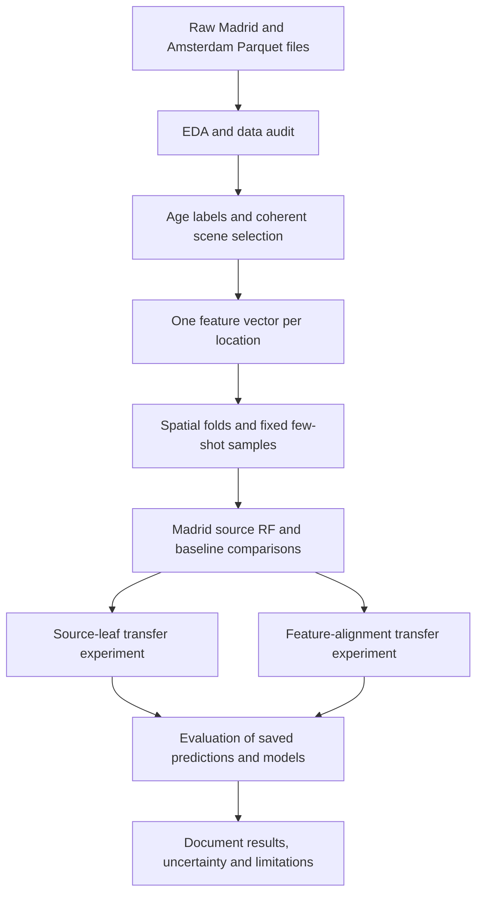

# Building-age classification: workflow, decisions and results

This document explains what we are trying to achieve, how the data becomes model input, why we made each major decision, what the experiments found, and what remains unfinished. Results describe the saved experiments and evaluation artifacts available on **3 November 2026**.

The project demonstrates that Madrid training data can help classify building ages in Amsterdam with few local labels. The strongest observed improvement from the follow-up experiments is at very small label budgets. We have **not** demonstrated a universally better transfer method or measured performance on an untouched organizer test set.

## 1. The hackathon task

For each **30 m × 30 m Landsat pixel**, predict one of four building-age classes. The challenge provides Madrid as the source training city and Amsterdam as the target city for adaptation.

The central objective is a model that can be adapted to another city with little local labeling. It is not enough to obtain a high score by learning Madrid-specific patterns.

The required Amsterdam budgets are:

| Labeled locations per class | Total labeled adaptation locations |
| ---: | ---: |
| 5 | 20 |
| 25 | 100 |
| 50 | 200 |
| 100 | 400 |
| 200 | 800 |

A location with measurements from many years still counts as **one labeled location**, not many labeled examples.

The [challenge introduction](1-Introduction.ipynb) calls for a trained Madrid model, reproducible adaptation code, cross-validation results, a presentation and a short written justification. Some presentation instructions mention four Amsterdam scores, but the evaluation procedure specifies five budgets; our experiments retain all five.

## 2. How to navigate the project

The original numbered notebooks describe the challenge and starter workflow. The added notebooks implement the subsequent EDA, preprocessing, baseline, transfer experiments and evaluation.

| File | Purpose |
| --- | --- |
| [1-Introduction.ipynb](1-Introduction.ipynb) | Challenge, data background and deliverables |
| [2-Reading_Data.ipynb](2-Reading_Data.ipynb) | Original data exploration |
| [3-Preprocessing.ipynb](3-Preprocessing.ipynb) | Original preprocessing workflow |
| [4-Modelling.ipynb](4-Modelling.ipynb) | Original random-forest modelling workflow |
| [eda.ipynb](eda.ipynb) | Detailed audit of both raw datasets |
| [preprocessing_age_labels.ipynb](preprocessing_age_labels.ipynb) | Explicit labels, location features, folds and adaptation samples |
| [baseline.ipynb](baseline.ipynb) | Source training and baseline transfer experiments |
| [transfer_improved.ipynb](transfer_improved.ipynb) | Experimental source-leaf adapters with inner model selection |
| [transfer_alignment.ipynb](transfer_alignment.ipynb) | Full and shrunk feature-distribution alignment |
| [evaluation.ipynb](evaluation.ipynb) | Independent metric recomputation, diagnostics and saved-model checks |

Despite its filename, `transfer_improved.ipynb` contains an **experiment**, not a guarantee that its method improves results. Its overall result was worse than the original blend.

The implemented path is:



[METRIC_LEARNING_APPROACH.md](METRIC_LEARNING_APPROACH.md) describes another proposed direction. It is not evidence that a neural metric-learning model was trained. The implemented models discussed here use scikit-learn.

## 3. What the dataset actually contains

The raw inputs are `data/madrid_train.parquet` and `data/amsterdam_data.parquet`.

| City | Raw pixel–year rows | Unique locations |
| --- | ---: | ---: |
| Madrid | 3,172,765 | 76,263 |
| Amsterdam | 1,062,877 | 25,992 |

A row represents a geographic pixel in a particular acquisition year. Up to three scene observations are stored in separate column groups for that year.

Each observation contains six spectral bands:

- Blue, Green and Red: visible-light measurements.
- NIR: near-infrared.
- SWIR1 and SWIR2: short-wave infrared.

The tables also contain quality flags, coordinates, acquisition years, building coverage, label eligibility and an area-weighted construction year.

The learning inputs are numerical spectral histories and summaries. We do not feed raw image tiles into a convolutional network or a vision transformer.

### Why repeat observations matter

Randomly splitting raw rows could place 1990 observations of a pixel in training and 2000 observations of the same pixel in validation. The model could benefit from recognizing that location rather than generalizing to unseen locations.

We therefore aggregate measurements into one feature vector per location, identified by `(city, px_key, py_key)`, before constructing model inputs.

A location is still not an independent building: one pixel can contain several buildings, and a building or neighborhood can affect adjacent pixels. This motivates spatial validation as well.

## 4. EDA: what we checked and why

[eda.ipynb](eda.ipynb) investigates the data before choosing modelling rules.

| Check | Why it matters |
| --- | --- |
| Schemas, data types and missing values | Detect incompatible files and unavailable observations |
| Duplicate location–year keys | Prevent accidental overweighting and ambiguous joins |
| Construction-year consistency across years | Avoid assigning contradictory labels to one location |
| Class counts at the location level | Measure the actual supply of labeled examples |
| QA flags and complete spectral observations | Separate usable measurements from incomplete scenes |
| Building coverage | Understand mixed building/background signals |
| Annual availability and observations per location | Identify gaps and sampling differences |
| Spectral distributions, extremes and correlations | Understand feature scales, redundancy and possible artifacts |
| City differences and spatial class patterns | Investigate distribution shift and spatial dependence |
| Few-shot feasibility | Confirm that budgets can fit outside evaluation folds |

Full-file integrity audits use all rows. Bounded, seeded samples are used where plotting millions of points would add cost without improving readability.

**We did not automatically delete spectral extremes.** Their interpretation depends on the stored scale and offset. The earlier notebooks' Blue > 15,000 threshold is examined as a diagnostic, not adopted as a verified physical cutoff in the new preprocessing workflow.

EDA also explored normalized spectral indices. Their interpretation remains provisional because additive offsets affect normalized differences; this influenced the decision to disable them in the default modelling features.

## 5. Creating the age labels

Raw files contain `weighted_mean_year`, not ready-made age classes. We bin that value using the city-event years already used in the original notebooks:

- Madrid: 1960.
- Amsterdam: 1945.

These historical boundaries and endpoint conventions still need organizer confirmation.

The implemented bins are **right-closed**:

| Class | Madrid | Amsterdam |
| ---: | --- | --- |
| 1 | 1850 ≤ year ≤ 1960 | 1850 ≤ year ≤ 1945 |
| 2 | 1960 < year ≤ 1984 | 1945 < year ≤ 1984 |
| 3 | 1984 < year ≤ 2004 | 1984 < year ≤ 2004 |
| 4 | 2004 < year ≤ 2024 | 2004 < year ≤ 2024 |

For example, exactly 1984 belongs to class 2, while 1984.5 belongs to class 3. Explicit boundary checks make this behavior visible.

Valid targets require a finite construction year in 1850–2024 and a usable label. A location is excluded from supervised training if its target years conflict across rows or any row marks its label unusable. Missing targets are not imputed.

### A limitation of the label definition

An area-weighted **mean construction year** is not the same as the majority building-age class. A pixel mixing very old and very new buildings can have an intermediate mean. We follow the existing project's binning convention, but this is a source of label ambiguity.

The class intervals are ordered, but their widths differ, and classes 1/2 differ between cities. A two-class error therefore cannot be converted directly into a construction-year error.

The resulting supervised location counts are:

| Class | Madrid | Amsterdam |
| ---: | ---: | ---: |
| 1 | 13,794 | 7,568 |
| 2 | 27,152 | 8,802 |
| 3 | 18,672 | 6,745 |
| 4 | 16,645 | 2,877 |

Amsterdam class 4 is substantially smaller than its other classes. Accuracy alone could hide poor performance on it, which is one reason macro F1 is the primary score.

## 6. Preprocessing decisions

### 6.1 Fix the observation cutoff

The challenge describes observations through 2024, but the files also contain 2025 data. The new workflow explicitly uses **1984–2024**.

| City | Rows excluded outside that window | Retained spectral rows |
| --- | ---: | ---: |
| Madrid | 76,216 | 3,096,549 |
| Amsterdam | 25,912 | 1,036,965 |

In this saved run, the coverage, complete-observation and target-eligibility checks did not remove additional locations. All 76,263 Madrid and 25,992 Amsterdam locations remained available for supervised features.

This cutoff is configurable. Changing it changes the feature histories and requires regenerating preprocessing and downstream results.

### 6.2 Keep each spectrum coherent

For each pixel–year, select the first observation slot that:

1. Has a true QA-valid flag.
2. Contains finite values for all six bands.

All six bands come from that same scene. Selecting bands independently could combine different acquisition dates into an artificial spectrum.

The first valid slot is a deterministic choice; it is not a claim that the earliest valid scene is always the physically best observation. If no slot qualifies, the row contributes no spectrum.

Coverage must be between 0.15 and 1, following the provided data rule. Duplicate location–year keys and missing identifiers cause explicit failures rather than silent fixes.

### 6.3 Describe observed history without inventing it

For each band we calculate nine summaries:

| Summary | Information represented |
| --- | --- |
| Mean | Average spectral level |
| Standard deviation | Variability over observed years |
| Median | A less extreme-sensitive central value |
| Minimum and maximum | Observed range |
| Early mean, through 2003 | Earlier-period conditions |
| Late mean, from 2004 | Later-period conditions |
| Late minus early mean | Fixed-period change |
| Slope per acquisition year | Linear temporal tendency using actual year gaps |

Six bands × nine summaries give **54 default features**.

Missing periods remain missing. A single observed year cannot establish temporal variability or a slope. We do not backfill a missing early history using later values or interpret a gap between observations as a one-year change.

This is retrospective classification through a fixed cutoff. Earlier observations may predate the current buildings. We do not filter observations using the target construction date, because that date would be unavailable at prediction time.

### 6.4 Separate metadata from predictors

Construction years, class labels, city names, location IDs and coordinates are excluded from model predictors. Coordinates define geographic folds; construction years define targets and diagnostic slices.

Eight availability features are exported, including counts of observed/eligible years, early/late availability and valid scene slots. They are excluded from default training because availability can encode city/sensor shortcuts. Their value would need a controlled ablation experiment.

Normalized spectral indices are disabled by default until reflectance encoding is confirmed.

### 6.5 Fit missing-value handling inside training pipelines

Feature tables are saved **unscaled**, with missing values intact. Each model pipeline fits a median imputer on its own training subset. Entirely missing training columns are retained to preserve the feature schema.

Random forests do not require standardization. Preprocessing also includes a training-only scaling demonstration for algorithms that do, but those demonstration arrays are not used as globally preprocessed cross-validation input.

This avoids leakage: validation values must not help determine training medians, scales or selected features.

## 7. Spatial validation and the label budget

We use five saved outer folds. Locations are grouped into blocks defined by integer division of coordinate keys by 20, then assigned using `StratifiedGroupKFold`.

The block size is **20 coordinate-key units**, not a verified physical distance. All locations in a block stay together. Blocks can touch, so some spatial dependence remains; no separation buffer was applied.

For outer fold `k`:

- Evaluation uses locations with `fold == k`.
- Source-city training or target-city adaptation uses eligible locations outside that fold.
- Amsterdam adaptation samples contain exactly `n` locations per class.
- No adaptation location or spatial block overlaps the evaluated Amsterdam fold.

We use three seeded sampling repetitions. Within a fold/repetition, budgets are nested: the 5-example sample is contained in the 25-example sample, and so on. This reduces differences caused purely by changing sample membership.

For each target method, five folds × three repetitions × five budgets produce **75 evaluation runs**. These are not 75 independent test sets: evaluation locations recur across budgets/repetitions, and cross-validation training pools overlap.

## 8. Training the baseline

### Why start with a random forest?

The problem is numerical tabular classification after temporal aggregation. A random forest handles nonlinear relationships, correlated inputs and different feature scales, provides a reproducible reference, and matches the original starter approach.

The predefined settings were:

- 150 trees.
- Square-root feature subsampling at splits.
- At least two training observations per leaf.
- Bootstrap class weighting with `balanced_subsample`.
- Seeded randomness, starting from seed 42.

There was no baseline hyperparameter search. We first established a fixed procedure that later methods could be compared against.

### Madrid evaluation and the final source model

Each Madrid validation fold gets a newly fitted pipeline trained outside that fold. The out-of-fold results are:

| Model | Madrid macro F1 |
| --- | ---: |
| Most-frequent dummy | 0.1313 |
| Random forest | **0.5755 ± 0.0153** |

The dummy measures performance without learning spectral relationships. The forest also obtains accuracy **59.42%**, balanced accuracy **56.46%**, and MCC **0.4392**.

After cross-validation, the same forest procedure is fitted on all Madrid locations and saved as the Stage 1 model. Its predictions on Madrid training data are not reported as held-out evaluation. It can be evaluated on Amsterdam, because no Amsterdam labels entered its training.

### Three Amsterdam reference conditions

1. **Source-only:** use the Madrid model without Amsterdam labels.
2. **Target-only:** fit a fresh forest on the permitted Amsterdam sample.
3. **Source + target:** average the two forests' class probabilities equally.

For each class `c`, the original transfer rule is:

```text
p_blend(c) = 0.5 × p_source(c) + 0.5 × p_target(c)
```

Predict the class with the largest blended probability. Probability columns are explicitly aligned by class label before averaging.

This is probability-level transfer, not fine-tuning the existing source trees. Target-only and transfer use exactly the same target forest and adaptation sample, isolating the contribution of source predictions.

The source-only Amsterdam macro F1 is **0.3462 ± 0.0152**, substantially below the Madrid result. This indicates a cross-city generalization problem, although it does not identify a single cause: materials, climate, sampling and label definitions can all differ.

## 9. Transfer experiment A: learning from source-tree leaves

The Madrid forest's final four probabilities compress a richer structure. We tested whether the leaf reached in each of its 150 trees could serve as a transferable representation.

The procedure:

1. Apply the frozen Madrid imputer and forest to the permitted target sample.
2. One-hot encode tree-specific leaf IDs; IDs are categories, not ordered numerical values.
3. Train a regularized logistic classifier for Amsterdam.
4. Compare leaf predictions alone or blended with source/target forests.

Eleven candidate recipes include the original blend, target-only RF, and three strengths of leaf-classifier regularization (`C = 0.1, 1, 10`) under three probability combinations.

### How candidate selection avoids spending extra labels

Candidates are scored using three inner spatial splits **inside the budget-limited sample**. Imputers, encoders and classifier heads are refitted on each inner training split. Unknown validation leaves are ignored, not added to the fitted vocabulary.

If a three-way split loses a training class, the procedure tries two splits. If no valid grouped split is available, it falls back to the original blend. Candidates within 0.005 of the best inner macro F1 favor earlier recipes, starting with the baseline.

The chosen recipe is refitted on the whole permitted sample, then evaluated on the outer fold. Outer labels never choose that run's recipe.

### Outcome

The nested procedure averaged **0.5680 macro F1 across budgets**, versus approximately **0.5721** for the original blend. It improved the mean at only one budget, by about 0.0002 at 50/class. A separately specified leaf-only `C=1` ablation was worse at every budget.

We retained this experiment rather than presenting it as an improvement. High-dimensional leaf features, source partition mismatch and noisy selection from small samples are plausible explanations, not experimentally isolated causes. See [the source-leaf report](docs/TRANSFER_RESULTS.md).

## 10. Transfer experiment B: aligning feature means and scales

The second experiment tests whether part of the city difference can be reduced by mapping target feature distributions toward the source distribution.

For each feature, full alignment applies:

```text
x_aligned = (x − target_mean) × source_std / target_std + source_mean
```

Source reference moments use Madrid training data with equal aggregate weight per class. This matches the target sample's equal-per-class allocation rather than letting Madrid's largest class dominate the reference.

Target moments use **only the permitted Amsterdam adaptation sample**. Evaluation features are transformed with those fixed values but never contribute to their estimation.

The aligned source probabilities are blended 50/50 with the ordinary target forest. The target branch still uses raw target features and its own training-only imputer.

### Why shrink the target estimates?

With only 20 total target locations at the smallest budget, means and variances can be unstable. The shrunk variant blends target moment estimates toward source moments:

```text
N = total adaptation locations = 4 × labels_per_class
w = N / (N + 40)

adjusted_mean = w × target_mean + (1 − w) × source_mean
adjusted_variance = w × target_variance + (1 − w) × source_variance
```

These are deliberately shrunk estimates, not a claim to compute the exact variance of pooled samples. The transformation uses the adjusted mean/variance. A fixed floor of 1% of source variance prevents excessive expansion of almost-constant target features; source variance also has a small numerical floor.

At 5 labels/class, `N=20` and `w=1/3`. More local evidence is used as the sample grows. The prior count 40 and variance floor were fixed design choices, not tuned from outer scores.

Full alignment was worse than the original blend at every budget. Shrinkage helped the smaller budgets. It does not align full covariance, guarantee class-conditional matching, or remove all cross-city differences.

## 11. Main Amsterdam results

Scores are mean macro F1 ± sample SD across five outer fold means. Each fold mean first averages its three sampling repetitions. Fold SD is not a confidence interval.

| Labels/class | Target-only RF | Original source/target blend | Shrunk alignment | Alignment Δ F1 | Folds improved |
| ---: | ---: | ---: | ---: | ---: | ---: |
| 5 | 0.4322 ± 0.0288 | 0.4737 ± 0.0279 | **0.4824 ± 0.0212** | +0.0087 | 5/5 |
| 25 | 0.5393 ± 0.0232 | 0.5494 ± 0.0258 | **0.5519 ± 0.0242** | +0.0025 | 4/5 |
| 50 | 0.5822 ± 0.0240 | 0.5887 ± 0.0254 | **0.5906 ± 0.0232** | +0.0019 | 3/5 |
| 100 | 0.6127 ± 0.0224 | **0.6168 ± 0.0232** | 0.6132 ± 0.0231 | -0.0035 | 1/5 |
| 200 | 0.6302 ± 0.0209 | **0.6321 ± 0.0233** | 0.6295 ± 0.0199 | -0.0026 | 2/5 |

The source blend helps relative to target-only training at every budget in these experiments. Its advantage is largest when labels are scarce. The follow-up shrinkage gains are smaller and do not continue at 100/200 labels per class.

Across the five budgets, average F1 is **0.5721** for the original blend and **0.5735** for shrunk alignment. The original blend has the higher peak budget mean, **0.6321 versus 0.6295**. These summarize development behavior under the hackathon categories; they do not predict prize outcomes.

We have not evaluated a single hybrid rule that switches methods after observing which one won each budget. Selecting such a rule from this table would itself be another model-selection decision requiring validation.

## 12. What evaluation adds beyond the headline F1

[evaluation.ipynb](evaluation.ipynb) independently recomputes **465 evaluation-run scores from 2,517,798 saved prediction rows**. The rows include repeated evaluation across methods, budgets and sampling repetitions; they are not 2.5 million independent labeled locations.

Evaluation verifies label agreement, complete validation-location coverage, fold assignments, exact budgets and spatial exclusions. Fresh inference from the saved source model and ten saved baseline/alignment models reproduces their recorded predictions.

### What the metrics mean

- **Precision:** among predictions of a class, how many are correct?
- **Recall:** among actual members of that class, how many are found?
- **Class F1:** the harmonic mean of precision and recall.
- **Macro F1:** the arithmetic mean of the four class F1 scores.
- **Accuracy:** the fraction of all correct predictions.
- **Balanced accuracy:** the mean of class recalls.
- **MCC:** a confusion-matrix-based measure of overall classification association.
- **Severe error fraction:** the fraction of predictions at least two ordered classes away from the true class; this is not measured in years.

An F1 of 0.55 does not mean exactly 55% of locations were classified correctly. That interpretation belongs to accuracy.

### Class performance at 25 labels/class

| Class | Baseline F1 | Alignment precision | Alignment recall | Alignment F1 |
| ---: | ---: | ---: | ---: | ---: |
| 1 | 0.6337 | 0.7206 | 0.5714 | 0.6353 |
| 2 | 0.5872 | 0.5404 | 0.6151 | 0.5737 |
| 3 | 0.4847 | 0.5602 | 0.4541 | 0.4977 |
| 4 | 0.4919 | 0.4263 | 0.6224 | 0.5008 |

Class 3 remains the weakest by F1. Alignment improves classes 3/4 partly through greater recall while class 2 loses recall. For class 4, precision remains low: many predictions of that class are wrong.

### The accuracy and error-severity trade-off

At 25 labels/class:

| Metric | Original blend | Shrunk alignment |
| --- | ---: | ---: |
| Macro F1 | 0.5494 | 0.5519 |
| Accuracy | 56.52% | 56.14% |
| Balanced accuracy | 55.59% | 56.57% |
| MCC | 0.4038 | 0.4015 |
| Errors spanning at least two classes | 8.63% | 9.85% |

A small improvement in the challenge's primary metric therefore does not establish better behavior for every practical use.

### Uncertainty and spatial stability

Evaluation resamples whole spatial blocks within outer folds, pairing the same resampled blocks across methods and repetitions. It uses 500 bootstrap draws.

At 25/class, the 2.5th–97.5th percentile interval for paired F1 change is approximately **[-0.0050, +0.0090]**, including zero. This is consistent with an uncertain small gain.

These intervals are conditional on the existing fitted models and fixed adaptation samples. They do not capture complete retraining uncertainty, overlapping-CV dependence, neighboring-block correlation or trying multiple development methods. We do not interpret them as selection-adjusted final-test confidence intervals or report statistical significance.

### Probability quality has a narrower evaluation scope

Probability diagnostics use saved Amsterdam **fold 0, repetition 0** models. Other runs saved hard predictions, so their calibration cannot be reconstructed from those labels alone.

At 25/class, baseline versus alignment scores on that one fold are:

| Metric, lower is better | Original blend | Shrunk alignment |
| --- | ---: | ---: |
| Log loss | 1.0546 | 1.0629 |
| Multiclass Brier score | 0.5826 | 0.5843 |
| Top-label ECE, ten bins | 0.0891 | 0.0980 |

Alignment does not improve these probability criteria in that example fold. These are not five-fold probability averages. ROC AUC, average precision and reliability-bin counts are also exported; ECE and reliability curves depend on binning and the number of observations per bin.

### Error slices

Diagnostics compare locations by building coverage, number of observed years and distance from age-class boundaries. These variables are used for explanation, not added to predictors.

For example, alignment at 25/class has mean subset accuracy around **48.35%** for locations within two years of a class boundary, versus **57.26%** farther away. Such subsets have different class mixtures, so this is an association, not proof that boundary proximity causes the errors.

## 13. Reproducibility and artifact organization

The raw data, model artifacts and prepared feature tables must be available locally. Generated model/preprocessing/evaluation directories are gitignored; cloning the code alone does not supply them.

From the project root:

```bash
uv sync --locked
uv run --with jupyter jupyter lab
```

Select a kernel using the project environment, restart it, and run each relevant notebook top to bottom in this order:

1. `eda.ipynb` — inspect inputs and assumptions; modelling does not depend on its optional exports.
2. `preprocessing_age_labels.ipynb` — generate features, labels, folds and membership files.
3. `baseline.ipynb` — fit/evaluate the baseline and save the source model.
4. `transfer_improved.ipynb` — reproduce the retained source-leaf experiment.
5. `transfer_alignment.ipynb` — reproduce the alignment experiments.
6. `evaluation.ipynb` — evaluate all saved experiments without fitting models.

Evaluation reads both transfer experiments' outputs, so both are required for its complete comparison. The original numbered notebooks provide context and a separate starter path; their outputs are not interchangeable with the newer feature schema. `main.py` is a placeholder and does not train these models.

The project requires Python ≥3.12; `.python-version` selects 3.14. The recorded experiments used Python 3.14.4 and scikit-learn 1.9.1. Exact dependency versions are captured by `uv.lock` and experiment metadata.

| Directory | Main contents |
| --- | --- |
| `data/preprocessed_age_labels/` | Row/location labels, unscaled features, spatial folds, few-shot membership, schema and hashes |
| `data/baseline/` | Source pipeline, baseline example adapters, predictions, metrics and plots |
| `data/transfer_improved/` | Leaf adapters, inner scores, selected recipes and outer evaluation outputs |
| `data/transfer_alignment/` | Alignment adapters, target/source moments and evaluation outputs |
| `data/evaluation/` | Recomputed metrics, block-resampling results, error slices and probability diagnostics |

The source pipeline is `data/baseline/madrid_source_model.joblib`. Saved Amsterdam example bundles exclude **fold 0** and usually represent repetition 0. They are not final models trained on all Amsterdam labels. Cross-validation predictions cover the other folds even though every fitted fold model was not retained.

Feature order is part of the model contract: use the ordered names in the saved configuration. Alignment bundles also depend on the matching source model and feature-construction rules. Keep their referenced directory structure or update paths deliberately. Fitted scikit-learn artifacts should be used with matching package versions.

Input hashes, configuration, seeds, versions and output manifests support reproducibility. Notebook execution counters can be cleared or become partial during interactive work; they are not a substitute for a fresh ordered run and verified artifacts. The result tables here summarize the saved evaluated runs, not a claim that every notebook's current interactive state is complete.

## 14. Skills used and implementation boundaries

The applied skill instructions are available under [docs/upstream-skills/](docs/upstream-skills/README.md):

- **scikit-learn:** preprocessing pipelines, supervised models, grouped validation and evaluation.
- **verification-before-completion:** checking actual outputs and saved artifacts before claiming successful results.

These are directly readable upstream copies with commit provenance in `SOURCE.json`. The managed `.agents` directory is read-only here, so these copies must not be described as a fully registered installation of every skill in the requested catalog. No model runtime dependencies were added just to obtain instructions.

No transformer, neural metric-learning, TRL/Unsloth training job or cloud training service is part of these results. Those require a separate compatible implementation and evaluation.

Skill reference: Kassis, T., Agarwal, V., He, Y., Patel, D., & Brueckner, A. M. (2026). *Scientific Agent Skills: A Library of Procedural Knowledge for Research Agents*. [arXiv:2609.00065](https://doi.org/10.48550/arXiv.2609.00065).

## 15. What is established, and what remains

**Established in the saved development experiments:**

- A reproducible numerical-feature workflow from raw pixel–year records to location-level classification.
- A Madrid RF substantially stronger than the most-frequent dummy.
- Useful source contribution relative to target-only RF, especially with very few local labels.
- Small low-budget gains from shrunk feature alignment, alongside explicit regressions/trade-offs.
- A documented leaf-representation experiment that did not improve overall results.
- Independent recomputation and saved-model prediction checks supporting the reported numbers.

**Still unresolved:**

- Organizer confirmation of historical boundaries and inclusivity conventions.
- Verified reflectance scale/offset before adopting spectral indices.
- Stronger spatial-independence checks, potentially with buffers or building groups.
- Whether the small gains survive a genuinely untouched external test.
- Broader calibration evaluation and a validated choice of final adaptation procedure.
- A final submission package, presentation and organizer-test evaluation; the notebooks alone are not the complete hackathon submission.

The outer development results have already informed later experiments. We should freeze a procedure before accessing organizer test labels, and keep any further feature selection, calibration or blend tuning inside training/inner validation. A claim of generalization to many cities would need evidence beyond this two-city experiment.

Detailed supporting reports:

- [Baseline results](docs/BASELINE_RESULTS.md)
- [Source-leaf transfer results](docs/TRANSFER_RESULTS.md)
- [Feature-alignment results](docs/TRANSFER_ALIGNMENT_RESULTS.md)
- [Model evaluation and limitations](docs/MODEL_EVALUATION.md)
